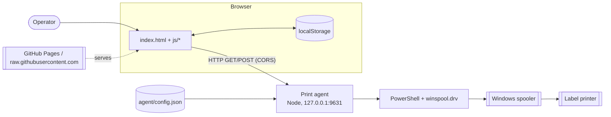
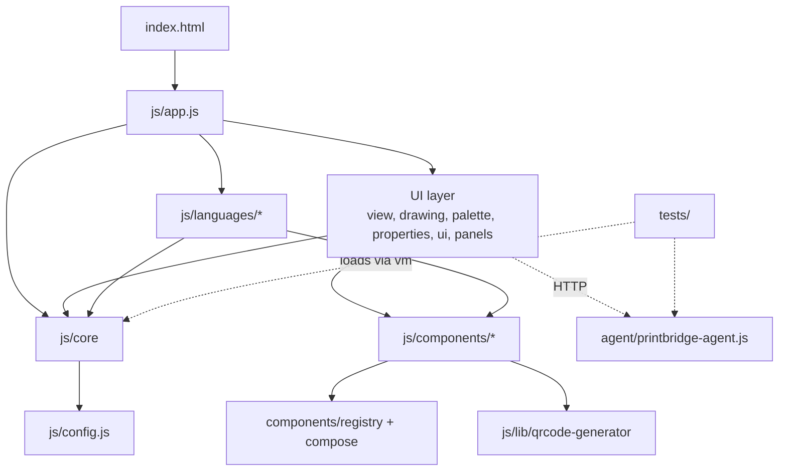
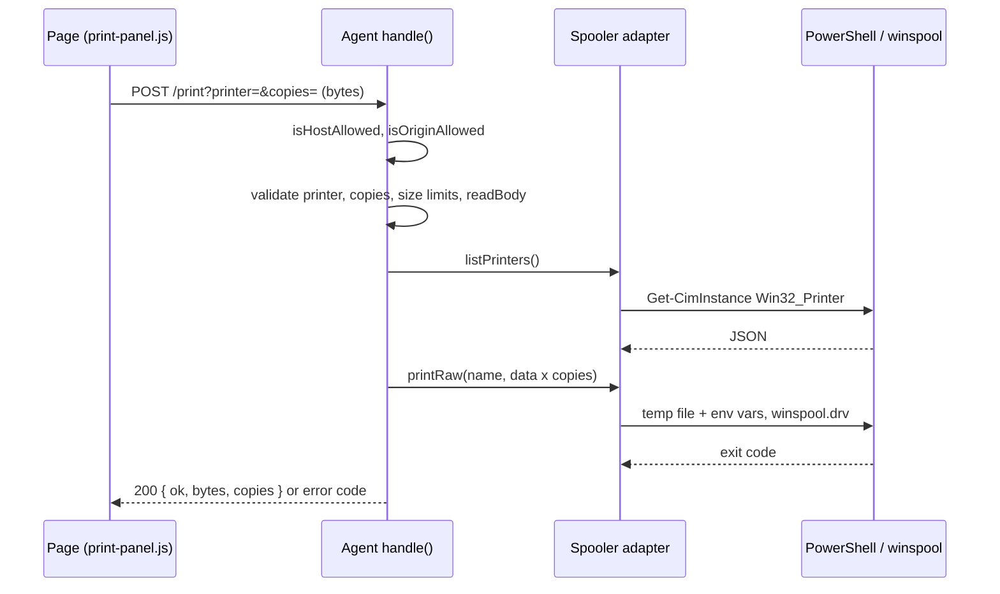

# Architecture

Line numbers refer to the commit stored in the manifest. Processes are referred to by their catalog id (`docs/.work/catalog.json`).

## 1. Context

PrintBridge is a static, no-build, vanilla JavaScript web app that draws label files (TPCL, TSPL, ZPL) without printing them, edits them, converts between the three languages and sends them to a printer (`openspec/config.yaml`, `index.html:1`). Printing goes through an optional local Node agent that talks to the Windows print spooler (`agent/printbridge-agent.js:3-5`).

| Element | Kind | Role |
|---|---|---|
| Label designer / operator | Actor | Opens the page, edits the label code, prints |
| Browser page (`index.html`) | System | Parses, validates, draws, converts and edits labels; no server side |
| Print agent (`agent/printbridge-agent.js`) | System | HTTP service on `127.0.0.1:9631` that forwards RAW bytes or a PNG to the spooler |
| Windows print spooler | External system | Receives RAW jobs (`winspool.drv`) or driver jobs (`IMAGE_SCRIPT`) through PowerShell (`agent/printbridge-agent.js:140-207`) |
| Label printer (TEC, TSC, Zebra) | External system | Physical device behind the spooler; sending to real hardware is unverified (`docs/.work/questions/bootstrap.md`) |
| GitHub Pages / raw.githubusercontent.com | External system | Hosts the live app (`README.md:6`) and the installer files (`agent/install.ps1:26`) |
| Browser `localStorage` | Store | Remembers print panel settings and collapsed sections (`js/print-panel.js:28-35`, `js/collapse.js:16`) |
| `agent/config.json` | Store | Optional agent configuration, git-ignored copy of `agent/config.example.json` (`agent/printbridge-agent.js:83`, `.gitignore`) |

The page works without the agent: preview, edit, convert, copy and download need no network after load. The agent is required by the browser printing flows (F3-F5); the .NET sample client also consumes the agent (F6).

## 2. Solution structure

There is no solution or workspace file: the browser page, Node.js agent, and .NET sample are separate entry points (`index.html:1`, `agent/printbridge-agent.js:3-6`, `dotnet/PrintBridge.Sample/Program.cs:4`). The sample targets .NET 10 and is a separate catalog feature (F6; `dotnet/PrintBridge.Sample/PrintBridge.Sample.csproj:1-8`).

| Module | Role | Depends on |
|---|---|---|
| `index.html`, `css/viewer.css`, `css/label.css` | Page structure and styles; lists the scripts in load order (`index.html:107-205`) | `js/*` |
| `js/manifest.json` | Single ordered list of scripts, shared by `index.html` and the tests (`tests/helpers/load.js:3-4`) | - |
| `js/config.js` | Known label sizes and example labels, published on `PB` (`js/config.js:2,31`) | - |
| `js/core/*.js` | Language-neutral model, units, diagnostics, language registry, validator, sizes, variables, emit context, conversion (`js/core/languages.js:72`, `js/core/validator.js:28`, `js/core/convert.js:94`) | `js/config.js` |
| `js/components/registry.js`, `js/components/compose.js` | Component registry and per-language slice composition (`js/components/registry.js:62,102`, `js/components/compose.js:19`) | none |
| `js/components/<kind>/*` | One slice per label item (text, barcode, qr, datamatrix, line, box, ellipse, area, image): render plus one file per language (`js/components/registry.js:50`) | registry, `js/core`, `js/lib/qrcode-generator.min.js` |
| `js/languages/*.js` | TPCL, TSPL, ZPL parsers/emitters, edit helpers and command help; each registers itself (`js/languages/tpcl.js:769`, `js/languages/tspl.js:772`, `js/languages/zpl.js:1163`) | `js/core`, slices |
| `js/view.js`, `drawing.js`, `palette.js`, `properties.js`, `ui.js`, `convert-panel.js`, `print-panel.js`, `render-export.js`, `collapse.js` | UI layer: preview, panels, PNG export, print client | `js/core`, slices |
| `js/app.js` | Entry point; creates the panels and connects parser, validation, drawing and messages, with no label logic (`js/app.js:1-4`) | all of the above |
| `js/lib/qrcode-generator.min.js` | Vendored QR library, used by the QR slice (`js/components/qr/matrix.js:13`) | - |
| `agent/printbridge-agent.js` | HTTP agent, spooler adapter, config and origin checks | Node built-ins only |
| `agent/install.ps1`, `agent/start.bat` | Install / launch scripts (`agent/install.ps1:1-26`, `agent/start.bat:1`) | Node on `PATH` |
| `dotnet/PrintBridge.Sample/` | Interactive .NET console client using `HttpClient` to list printers and submit RAW/image jobs (F6; `dotnet/PrintBridge.Sample/Program.cs:4-43`, `PrintBridgeClient.cs:1-40`) | local HTTP agent |
| `tests/` | `node:test` suites; the agent runs against a fake spooler, the page modules are loaded with `vm` (`tests/helpers/load.js:7`) | all |

Global namespace pattern: every script is an IIFE that augments `globalThis.PrintBridge` (alias `PB`), for example `js/config.js:31`, `js/app.js:601`, `js/components/registry.js:103`. Dependencies are expressed only by script order, which must be kept in sync in `index.html` and `js/manifest.json` (`index.html:106`, `tests/helpers/load.js:3`).

Extension points: a language is added with `PB.languages.register({ id, name, detect, parse, emit, ... })`, which throws on a missing member or a duplicate id (`js/core/languages.js:72-76`); a component with `PB.components.register(def)` (unique `kind`, `js/components/registry.js:62-71`); `composeSlices(langId, helpers, base)` merges each slice's per-language hooks (`js/components/compose.js:19-30`).

## 3. Libraries

| Library | Version | Use | Source |
|---|---|---|---|
| qrcode-generator | not stated in the file (inferred from code: the minified `qrcode` library) | QR matrix generation for the QR slice | `js/lib/qrcode-generator.min.js:1`, `js/components/qr/matrix.js:13` |
| Node.js built-ins (`http`, `fs`, `os`, `path`, `crypto`, `child_process`) | Node 18 or newer to run the agent | Agent server, temp files, PowerShell launch | `agent/printbridge-agent.js:26-31`, `agent/README.md:21` |
| `node:test`, `node:assert/strict`, `node:vm` | Node 22 or newer | Test runner and fixtures | `openspec/config.yaml`, `tests/helpers/load.js:7-9` |
| PowerShell (`powershell.exe`), `winspool.drv`, WMI `Win32_Printer` | OS provided | Printer listing and RAW/driver jobs | `agent/printbridge-agent.js:143,160-166,347` |
| .NET SDK | 10 (`net10.0`) | Console sample client (F6) | `dotnet/PrintBridge.Sample/PrintBridge.Sample.csproj:1-8` |

The web application has no package manifest, npm runtime dependency, or build step (`agent/printbridge-agent.js:6`). The agent uses Node.js built-ins; the .NET sample targets `net10.0` and declares no package references (`dotnet/PrintBridge.Sample/PrintBridge.Sample.csproj:1-8`). Internal packages: none.

## 4. Composition (DI)

There is no DI container. Composition is done in these ways:

- **Browser**: script load order plus the `PB` namespace. `js/app.js:8` destructures its collaborators from `PB` and builds each panel with a factory (`ui.createMessagesPanel`, `createVariablesPanel`, `createEditor`, `createPreview`, `createPalette`, `createPropertiesPanel`, `js/app.js:29-82`). The print panel receives its dependencies: `ui.createPrintPanel({ root, getBytes, getLabel })` (`js/app.js:77`), whose `fetch`, `storage` and `renderPng` default to the browser globals and can be replaced (`js/print-panel.js:136`).
- **Registries**: `PB.components` and `PB.languages` are write-once registries (`js/components/registry.js:102`, `js/core/languages.js:72`). Slices register themselves from their `index.js` (for example `js/components/text/index.js:10`).
- **Agent**: `createServer({ spooler, config, log })` takes the spooler as an injected interface and refuses a spooler without `listPrinters()` and `printRaw()` (`agent/printbridge-agent.js:441-445`); `main` wires the real `createWindowsSpooler()` (`agent/printbridge-agent.js:606`). The tests inject a fake spooler (`agent/printbridge-agent.js:8-11`).
- **Options binding**: `normalizeConfig` merges `config.json` over `DEFAULT_CONFIG` and validates each key (`agent/printbridge-agent.js:40-80`); `loadConfig` treats a missing file as the defaults (`agent/printbridge-agent.js:83-89`).
- **Lifetimes**: No aplica (no container). `createServer` builds one `config` that lives for the whole process (`agent/printbridge-agent.js:442`).

## 5. Flows

### 5.1 HTTP (agent)

Every request passes the same host and optional-origin checks (`agent/printbridge-agent.js:459-466`). Routes are `GET /health` (diagnostic `-`), `GET /printers` (F5), `POST /print` (F3), and `POST /print-image` (F4), plus the `OPTIONS` preflight (`agent/printbridge-agent.js:469-505`, `docs/.work/catalog.json`).

`POST /print-image` has the same shape, but validates the query with `parseImageQuery` (`agent/printbridge-agent.js:290-308`), requires a PNG (`agent/printbridge-agent.js:558`) and calls `spooler.printImage` (`agent/printbridge-agent.js:573`).

### 5.2 Browser (UI events)

The browser page is event-driven and has no job queue or message-consumer process. An edit in the textarea, a palette drop, a properties change or a file load calls `refresh()` in `js/app.js`, which runs language detection and parse, `validator.validate`, then draws and publishes messages (F1). Conversion (F2) calls `PB.convert.run` (`js/core/convert.js:94`). The print client (F3-F5) calls `check()` against `/health` then `/printers` (`js/print-panel.js:264-293`), then `printRaw()` or `printImage()` (`js/print-panel.js:324-387`); image mode renders the SVG to a PNG on a canvas in `js/render-export.js:172`.

### 5.3 .NET sample client (F6)

The console client requests `/printers` and sends print jobs through the agent over HTTP; it is a client, not a host for the agent (`dotnet/PrintBridge.Sample/Program.cs:4-43`, `dotnet/PrintBridge.Sample/PrintBridgeClient.cs:1-36`).

### 5.4 Process start

`node agent/printbridge-agent.js [--config <file>]` loads the config, builds the server and listens on `127.0.0.1:<port>` (`agent/printbridge-agent.js:596-617`). `agent/start.bat` runs it in a console and `agent/install.ps1` downloads it and can register a Scheduled Task (`agent/install.ps1:117-126`).

## 6. Transactions

No database and no transaction manager exist. The only multi-step write is a print job: the agent writes a temp file in `os.tmpdir()`, runs PowerShell, then deletes the file in a `finally` block (`agent/printbridge-agent.js:380-386`, `391-397`). The spooler job is the unit of work; copies are the data repeated N times inside one spooler job (`agent/printbridge-agent.js:21,534`), so they succeed or fail together. A spooler error after the file was written answers `spooler_error` and the temp file is still removed. Cross-store writes: none (the page's `localStorage` writes are independent and tolerate failure, `js/print-panel.js:139`).

## 7. Error handling

- **Agent**: `fail()` returns `{ ok: false, error, message, detail? }` with a fixed Spanish message per code (`agent/printbridge-agent.js:406-415,453-457`). Codes and statuses: `origin_refused` 403, `bad_request` 400, `printer_not_found` 404, `too_large` 413, `not_png` 415, `spooler_error` 502, `not_found` 404, `method_not_allowed` 405. A top-level `.catch` on `handle` turns an unexpected exception into `spooler_error` 502, or destroys the socket if headers were already sent (`agent/printbridge-agent.js:582-587`). `detail` is truncated to 300 characters (`agent/printbridge-agent.js:455`).
- **Limits**: a body over `maxBytes` (declared or counted) answers 413 with `Connection: close`; body times copies over 100 MB answers 413 (`agent/printbridge-agent.js:515-522`, constant at `:37`). PowerShell is killed after 60 s (`agent/printbridge-agent.js:38,356`).
- **Startup**: an invalid config exits with code 1 and a message; `EADDRINUSE` prints a hint and exits 1 (`agent/printbridge-agent.js:599-612`).
- **Page**: parse problems become diagnostics (`js/core/diagnostics.js`) shown in the Avisos panel (`index.html:100`); the print panel maps agent error bodies to Spanish messages (`js/print-panel.js:125-130`) and an unreachable agent turns the panel to "no disponible" (`js/print-panel.js:309-321`). There is no global `window.onerror` handler (inferred from code: none found in `js/`).
- **Retries**: none in the agent; the user retries with the "Reintentar" button (`js/print-panel.js:420`). The Scheduled Task restarts a dead agent up to 3 times at 1 minute intervals (`agent/install.ps1:123-124`).

## 8. Logging / observability

- **Agent**: plain `console.log` / `console.error`, injectable through `log(line)`; each job logs one line with timestamp, printer name, bytes and copies, or `FAILED` (`agent/printbridge-agent.js:441,538,541,575,578`). Startup logs version, address and allowed origins (`agent/printbridge-agent.js:614-615`). The label data is never logged (`agent/printbridge-agent.js:21`). No log levels, files, enrichers, correlation ids or metrics. When started by the Scheduled Task the process is hidden, so its console output is not captured (inferred from code: `-Hidden` at `agent/install.ps1:123`, no redirect).
- **Page**: no logging framework; user-facing messages only (`onMessage` callback, `js/print-panel.js:136`).

## 9. Security

- **Authentication / authorization**: none (no token or credential). Protection is network and origin based: the server listens on `127.0.0.1` only (`agent/printbridge-agent.js:34,614`), rejects any `Host` that is not `127.0.0.1` or `localhost` (DNS-rebinding defence, `agent/printbridge-agent.js:128-133,461`), and rejects an `Origin` outside `allowedOrigins`; `null` (file://) needs `allowFileOrigin` (`agent/printbridge-agent.js:108-126`). A request without `Origin` (curl, native clients) passes the origin check (`agent/printbridge-agent.js:463`), so any local process can print.
- **CORS / Private Network Access**: the preflight answers `Access-Control-Allow-Private-Network: true` only to allowed origins (`agent/printbridge-agent.js:469-479`).
- **Injection**: the printer name and file path travel in environment variables, never in the PowerShell command text (`agent/printbridge-agent.js:135-137,310-323,383`); the script is passed with `-EncodedCommand` and `-ExecutionPolicy Bypass` (`agent/printbridge-agent.js:346-347`).
- **Secrets**: none detected. The configuration keys are `port`, `allowedOrigins`, `allowFileOrigin`, `maxBytes`, `maxImageBytes` (`agent/config.example.json`); none is secret.
- **Installer**: `agent/install.ps1` is meant to run through `irm ... | iex` from the `main` branch and downloads the agent from the same branch (`agent/install.ps1:8,26,98`); no pinned version or checksum.
- **Page**: `innerHTML` is used in `js/drawing.js` and `js/ui.js`; its inputs were not audited in this section.
